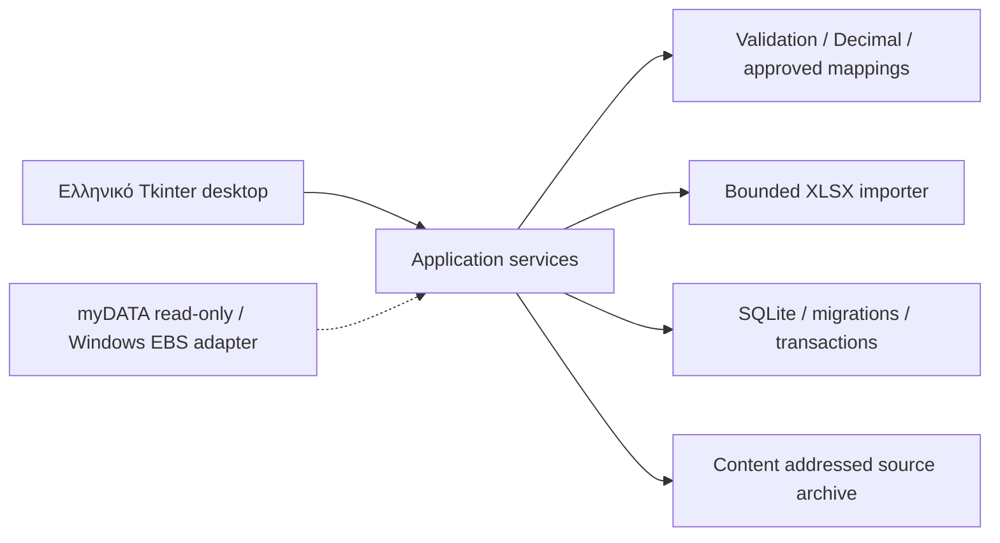

# Audit EBS Batch Agent v2.9 και πρώτο MVP

Εξετάστηκαν όλα τα Python modules, tests, launchers, manifest και συνοδευτικά README του handoff. Η αναφορά παραμένει εκτός νέου repository στο `/workspace/reference-handoff`, χωρίς αλλαγές. Δεν υπάρχει τεκμηριωμένη άδεια επαναδιάθεσης του legacy: απαιτείται επιβεβαίωση δικαιωμάτων πριν δημοσίευση. Κανένα push δεν εκτελείται.

## Inventory και συμβόλαια
| Module | Callables / συμβόλαιο | Απόφαση |
|---|---|---|
| universal_excel.py | norm, column_index, sheets, read_sheet, detect, money, date_str, load(path,manual_mapping=None) → records/report | Επιλεκτική επαναχρησιμοποίηση aliases, XML reader και Decimal parsing. Το legacy επιστρέφει vat/invoice/date/net/mark/gross/tax, ημερομηνίες DD/MM/YYYY και net με κόμμα. Νέο συμβόλαιο ISO, cents, χωριστή σειρά/αριθμός και raw row. |
| mapping_advisor.py | history_counts(path), recommend(vat,explicit_mappings,history_path) | Νέα υπηρεσία μόνο από ρητές εγκρίσεις. Το legacy δέχεται ως ιστορικό και save_clicked_new_ted_opened_not_database_verified. Δεν μεταναστεύουμε αυτόματα το ιστορικό. |
| ebs_diagnostics.py | ebs_windows, process_snapshot, Diagnostics.log/exception/snapshot/report, ui_locator_report, event_log_export, uia_handle_status | Επαναχρησιμοποίηση αρχών καταγραφής/προαιρετικών metrics, όχι Windows κλήσεων στην εφαρμογή. psutil προαιρετικό, pywinauto/robocorp μόνο για μελλοντικό adapter. |
| one_invoice_test.py | App, type_unicode_exact, FIELDS, mapper loading, _validate_target, next_field, save_and_new | Ισχυρή εξάρτηση Tk/pyautogui/ctypes Win32. Import μπορεί να ζητήσει input/exit εάν λείπει pyautogui. Δεν εισάγεται ως library. Η ακολουθία ημερομηνίας παραμένει αυτούσια στο reference. |
| batch_agent.py | BatchApp(App), start_batch/_next_record/next_field/_save_record/_open_next_ted, pause/resume/stop, record/_journal_state, mapping learning, diagnostics, search | UI και orchestration συζευγμένα. Μεταφέρονται μόνο έννοιες job/status αργότερα. Inclusive start, διατήρηση σειράς Excel, παύση ανά 40. |

## Ευρήματα και κίνδυνοι
- `Save → New TED` δεν αποδεικνύει commit στην EBS database. Η τελευταία εγγραφή και η παύση συντήρησης μένουν αβέβαιες. Δεν υπάρχει authoritative ERP read-back.
- Το journal fsync γίνεται πριν το Save, αλλά start_batch δεν αποκλείει MARK με processing/save_uncertain/ui_saved_review: κίνδυνος replay μετά από crash. Το pilot_ok ορίζεται αλλά δεν επιβάλλεται στο start_batch.
- Header detection δεσμεύει την πρώτη αντιστοίχιση: διφορούμενες στήλες χρειάζονται ανθρώπινη επιβεβαίωση. MARK είναι υποχρεωτικό στο legacy, όχι σε τοπικό ERP.
- Δεν υπάρχουν ZIP expansion/row limits, χειρισμός 1904 epoch, formula validation, πλήρης διατήρηση raw payload ή transactions. money κενό → μηδέν και δέχεται nonfinite Decimal. Πιστωτικά απορρίπτονται από τη legacy ροή.
- MARK-only dedupe δεν καλύπτει εταιρεία/κατεύθυνση/είδος/σειρά/αριθμό. Το νέο MVP κρατά και business identity και MARK, απορρίπτοντας conflicts αντί overwrite.
- Tk callbacks περιέχουν time.sleep και polling loops: πιθανή μη απόκριση. Νέα βαριά import εργασία σε worker, UI ενημέρωση μόνο στο Tk thread.
- Diagnostics/window titles/tracebacks μπορεί να περιέχουν εμπορικά δεδομένα. Δεν μεταφέρονται logs ή VAT identifiers των legacy tests σε fixtures.
- Legacy tests: importer εξαρτάται από εξωτερικό αρχείο και συνήθως γίνεται skip· mapping/diagnostics unit tests δεν επαληθεύουν Win32, πραγματικό Excel ή EBS persistence.

## Αρχιτεκτονική


```text
app/domain/                 validation and monetary rules
app/application/            import, search, detail, approval services
app/infrastructure/importers/ XML workbook reader and aliases
app/ui/                     Tk desktop, worker queue
migrations/                 ordered transactional SQL
scripts/                    synthetic demo generation
 tests/                     domain/import/database integration
```

## Database schema
Υλοποίηση πρώτης τομής: companies(id,vat,name), counterparties(id,company_id,vat,name,role), import_jobs(id,company_id,filename,sha256,status,report,created_at), source_records(id,job_id,row_number,raw_json), documents(id,company_id,counterparty_id,source_record_id,direction,kind,series,number,issue_date,mark,net_minor,tax_minor,gross_minor,currency,status), audit_events(id,actor,action,entity_id,payload,created_at), account_mappings(company_id,counterparty_id,account,approved_by). Foreign keys, μοναδικότητα ανά εταιρεία και ταυτότητα παραστατικού, partial unique MARK index. Ποσά ακέραια λεπτά EUR μέσω Decimal, καμία στρογγυλοποίηση χωρίς έλεγχο, ΑΦΜ TEXT. Raw source αμετάβλητο με triggers και διατήρηση XLSX SHA256. Jobs και όλα τα inserts σε μία transaction: crash rollback, ασφαλές retry.

Επόμενες migrations: accounting_periods, document_lines, attachments(hash/path/type), mapping_history, rpa_jobs/rpa_job_items και sync_cursors. Δεν προσποιούμαστε ότι έχουν υλοποιηθεί. Τα όρια tenant περνούν ρητά στις υπηρεσίες. Αρχικό UI μία εταιρεία, όχι multiuser.

## ADR-001: Desktop
Tkinter για μικρό dependency footprint, Windows standard Python και άμεση υλοποίηση της τομής. PySide6 καλύτερο για σύνθετα grids/accessibility αλλά με packaging/deployment κόστος. Καμία αντιγραφή BatchApp. Βαριά parsing σε background thread, μεταφορά αποτελέσματος μέσω queue. Επανεξέταση PySide6 πριν μεγάλης έκτασης UI.

## ADR-002: Database
SQLite WAL σε τοπικό δίσκο, foreign keys, versioned SQL migrations, transactions, sqlite backup API και integrity check. Όχι ενεργή βάση σε SMB/NAS. PostgreSQL και υπηρεσία μόνο όταν απαιτηθεί multiuser. Audit append-only στην εφαρμογή/SQL triggers, όχι tamper-proof απέναντι σε διαχειριστή αρχείου.

## Συγκεκριμένο σχέδιο
1. Πρώτη λειτουργική τομή: δύο συνθετικά Excel με διαφορετικές στήλες → mapping preview/edit → row exceptions → επιβεβαίωση → transaction → λίστα/αναζήτηση → detail/raw/timeline. Restart persistence, duplicate/conflict handling και tests.
2. Μητρώο αντισυμβαλλομένων με editing/history, εγκεκριμένο account mapping, ασφαλές PDF archive, filters και export. Ξεχωριστό acceptance milestone.
3. Backup/restore acceptance, dashboard, approved classification, περίοδοι.
4. myDATA read-only μόνο μετά ανάγνωση τρέχουσας επίσημης προδιαγραφής. EBS opt-in Windows adapter, κανένα direct DB write. save_invoked ≠ confirmed_in_erp, uncertain ποτέ αυτόματο retry.
5. Payments/ledger/issuance εκτός MVP· απαιτούν λογιστικό έλεγχο, κανόνες και έγκριση.

## Screens / έλεγχοι πρώτης τομής
Εισαγωγή με προεπισκόπηση mapping, απορρίψεις και έγκριση. Παραστατικά με αναζήτηση σε ΑΦΜ/επωνυμία/αριθμό/MARK. Detail με ποσά/προέλευση/raw/timeline. Tests: cents/NaN, leading-zero ΑΦΜ, mixed suppliers, διαφορετικά layouts, combined/separate invoice, ZIP limits, formulas, duplicates/conflicts, transaction rollback, reopen, audit immutability, migration repeatability. Τοπική δοκιμή GUI στο Linux όπου διατίθεται display· Windows/EBS ανεπιβεβαίωτα.
