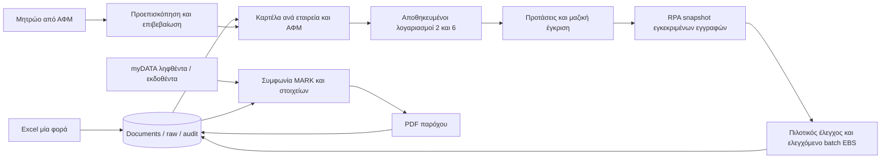

# Συνδεδεμένη ροή · 22/10/2026

Η προηγούμενη παράδοση ήταν κατακερματισμένη: τα documents υπήρχαν στη βάση,
ενώ το RPA έδειχνε άδεια δεύτερη λίστα και υποστήριζε μόνο fill χωρίς Save.
Η διόρθωση χρησιμοποιεί την ίδια λίστα και τα ίδια document IDs σε όλες τις
ενέργειες, με τη βάση ως κοινό σημείο αναφοράς. Δεν ξαναφορτώνεται Excel στο RPA.

## Τι διατηρείται από τον πραγματικό agent

Εξετάστηκαν εκ νέου `batch_agent.py`, `one_invoice_test.py` και README v2.9.
Η ανεξάρτητη υλοποίηση διατηρεί τη σειρά πέντε πεδίων, την ειδική πληκτρολόγηση
ημερομηνίας από το πρώτο ψηφίο, Save → πρόσθετο νέο ΤΕΔ, τελευταίο Save χωρίς
άλλο νέο ΤΕΔ, συμπεριλαμβανόμενη επιλεγμένη εγγραφή, παύση στα 40 πριν από νέο
ΤΕΔ, έλεγχο νέου HWND, έλεγχο modal/process και global operator shortcuts.
Δεν εισάγεται το Tk App του baseline ως engine. Τα αρχικά αρχεία δεν αλλάζουν.

`started` αποθηκεύεται πριν την πληκτρολόγηση και `save_pending` πριν το Save.
Crash σε αυτά γίνεται `uncertain`. `save_invoked` / `ui_saved_review` δεν
σημαίνουν confirmed_in_erp. Δεν γίνεται blind replay μετά από αβέβαιη ή
πραγματική προηγούμενη προσπάθεια. Οι εγκρίσεις ελέγχονται ξανά για όλη την
εκκρεμή ουρά πριν την επόμενη native ενέργεια. Αλλαγή θέσεων ακυρώνει το pilot.
Ο χρήστης διευκρίνισε ότι δεν θα καταχωρούνται ποτέ αγορές ομάδας 2 από το
Mini ERP. Η ομάδα 2 παραμένει για διαχωρισμό αγορών/προμηθευτών. Το RPA και η
προσομοίωσή του δέχονται μόνο έξοδα ομάδας 6. Η μικτή λίστα εμφανίζει πόσες
αγορές εξαιρούνται, ενώ αταξινόμητες εγγραφές απαιτούν έλεγχο αντί να
θεωρηθούν σιωπηλά έξοδα.

## Καρτέλες και επαναχρησιμοποίηση λογαριασμών

Μοναδικότητα εταιρεία+ΑΦΜ, σταθερός κωδικός `ΣΥΝ-<id>`, πολλαπλοί ρόλοι.
Το λογιστικό σκέλος είναι μόνο εγκεκριμένες προεπιλογές 2/6 ανά καρτέλα, όχι
ολόκληρη διαχείριση λογιστικού σχεδίου. Προτάσεις συμπληρώνονται στις νέες
εγγραφές, χωρίς αυτόματη έγκριση ή εγγραφή EBS. Η μαζική έγκριση και audit
είναι ατομική συναλλαγή. Προϋπάρχουσες εγκρίσεις παραστατικών δεν αλλάζουν όταν
διορθώνεται η καρτέλα. Δύο ιστορικοί λογαριασμοί δεν οδηγούν σε τυφλή επιλογή.

## myDATA: πρωτογενής τεκμηρίωση που ανακτήθηκε

Η [επίσημη σελίδα](https://www.aade.gr/mydata/tehnikes-prodiagrafes-ekdoseis-mydata)
ήταν πλέον προσβάσιμη. Ανακτήθηκαν με TLS:

- [ERP REST v2.0.2, Σεπτέμβριος 2026](https://www.aade.gr/sites/default/files/2026-09/myDATA%20API%20Documentation%20v2.0.2_official_erp_1.pdf)
- [Επίσημα XSD v2.0.2](https://www.aade.gr/sites/default/files/2026-09/v2.0.2XSDs_0.zip)

Διαβάστηκαν τα auth headers (4.1), RequestDocs (4.2.6), RequestTransmittedDocs
(4.2.7), response/continuation (6.2) και downloadingInvoiceUrl (5.1, παρ. 11),
καθώς και RequestedDoc/InvoicesDoc XSD. Το RequestDocs αφορά στοιχεία άλλων που
αφορούν την εταιρεία· το RequestTransmittedDocs στοιχεία που η ίδια διαβίβασε.
Η εκπροσώπηση προσθέτει entityVatNumber μόνο όταν επιλέγεται ρητά.

Οι κλήσεις εκθέτουν μόνο GET λήψης, fixed official hosts, χωρίς redirects
κωδικών, bounded pagination/retry/response, UTF-8 XML χωρίς entities και
ασφαλή μηνύματα. Κάθε λήψη μεθόδου αποθηκεύεται ατομικά αφού ληφθούν όλες οι
σελίδες της, με immutable XML/hash. Δεν υπάρχει incremental cursor/resume:
διακοπή επαναλαμβάνει το διάστημα από MARK 0 και το upsert παραμένει idempotent.
Μεγάλες περίοδοι χρειάζονται μικρότερο διάστημα (100 σελίδες / 64 MB).
Δεν γίνεται ισχυρισμός ότι μεταφέρθηκε ολόκληρο το sync engine του myInvoices.

Η συμφωνία ελέγχει MARK, εταιρεία, κατεύθυνση, ΑΦΜ, αναφορά, ημερομηνία και ποσά.
Διαφορά ή αναφορά ακύρωσης παραγωγής αποκλείει το RPA μέχρι έλεγχο. Δεν
διαγράφεται/ακυρώνεται τοπικό τιμολόγιο αυτόματα. Εκδοθέντα ή άλλα παραστατικά
που δεν υπάρχουν στο Excel διατηρούνται στο ξεχωριστό inbox ΑΑΔΕ, με καρτέλες
αντισυμβαλλομένων/PDF, όχι αυτόματη μετατροπή σε υποστηριζόμενη τοπική αγορά.

## Η σωστή έκδοση myInvoices

Ο χρήστης έδωσε το συγκεκριμένο repo/commit:
https://github.com/gkampanis/legend/tree/36a1539c71102f89ecfdd26bf25283d293f86c8d
(myInvoices v0.13.0). Η παλιότερη αναφορά στο File Organizer αφορούσε άλλο HEAD
και δεν περιέγραφε αυτόν τον κώδικα. Διαβάστηκαν README, AGENTS και οι σχετικές
τεχνικές αναφορές και modules. Το repo παραμένει αμετάβλητο.

Επιλέχθηκαν αυτούσια modules χωρίς GUI/παλιά database/credentials στο
`app/infrastructure/providers`: models, batch, local_files, provider_documents,
pdf_downloads, browser_downloads, print_fallback, automatic_downloads,
browser_recovery και xml_parser. Το `ProviderDatabase` είναι adapter στη νέα
βάση. Δεν αντιγράφηκαν υπάρχοντα δεδομένα, πελάτες ή browser profiles.

Οι direct/dynamic downloads, εκτύπωση αναγνωρίσιμου HTML, ξεχωριστό headful
recovery, ανθρώπινο challenge, ασφαλές archive/no-overwrite και περιβάλλον ανά
εταιρεία προέρχονται από αυτή την υλοποίηση. Αρχικό, εκτύπωση και verified PDF
δεν συγχέονται. API headers δεν μεταφέρονται σε παρόχους. Επιτυχία σε synthetic
Chromium δεν αποτελεί εγγύηση για κάθε πραγματικό πάροχο.

## Μητρώο επιχειρήσεων

Εξετάστηκε η [επίσημη υπηρεσία ΑΑΔΕ](https://www.aade.gr/anazitisi-basikon-stoiheion-mitrooy-epiheiriseon)
και το [developer bundle v1.1](https://www.aade.gr/sites/default/files/2023-07/RgWsPublic2DevelopersInfoV1.1.zip).
Το readme και τα επίσημα SOAP request/response examples τεκμηριώνουν SOAP 1.2,
WS-Security UsernameToken, action και namespaces για RgWsPublic2AfmMethod.
Υλοποιείται ξεχωριστό credential namespace και lookup για το ΑΦΜ καρτέλας,
με ρητή επιβεβαίωση ονόματος/διεύθυνσης/ΔΟΥ πριν τοπική ενημέρωση.
Δεν χρησιμοποιούνται κωδικοί TAXISnet ή myDATA στη θέση ειδικών κωδικών.
Δεν έγινε πραγματική κλήση με κωδικούς χρήστη.

## Υποχρεωτικά όρια αποδοχής

Πριν παραγωγικό batch απαιτείται Windows/EBS δοκιμή με τις πραγματικές θέσεις
και έλεγχος πραγματικού αποθηκευμένου ΤΕΔ. Ο cloud fake adapter ελέγχει σειρά,
καταστάσεις και αποφυγή replay, όχι σωστή φόρμα/λογιστικό αποτέλεσμα EBS.
Native Credential Manager, Win32, ειδικοί κωδικοί και πραγματικές εξουσιοδοτήσεις
δεν έχουν επαληθευτεί εδώ. Το user-owned repo χρησιμοποιείται ως πηγή κατόπιν
ρητής υπόδειξης του χρήστη· δεν γίνεται δήλωση άδειας τρίτου έργου που δεν βρέθηκε.
