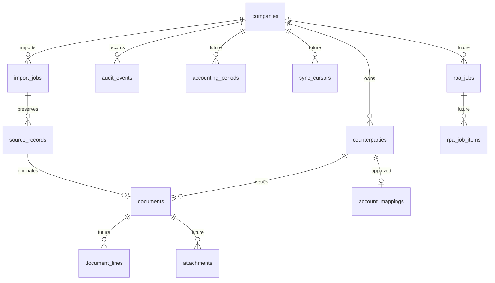

# Schema: υλοποίηση και roadmap

Οι `migrations/001_initial.sql` και `002_preparation.sql` είναι η εκτελέσιμη πηγή αλήθειας. Η δεύτερη προσθέτει document_preparations(document_id,company_id,nature_group,account_code,note,approved_by,approved_at) με tenant-integrity triggers και ξεχωριστό audit από τα imported δεδομένα. Οι μελλοντικοί πίνακες παρακάτω είναι σχεδιασμός και δεν δημιουργούνται ακόμη.

| Ενότητα | Προτεινόμενα πεδία / constraints μετά την πρώτη τομή |
|---|---|
| accounting_periods | id, company_id, start_date, end_date, state(open/closed), closed_by, closed_at. Απαγόρευση overlapping periods και αλλαγών σε κλειδωμένη περίοδο μόνο μετά χωριστό domain review. |
| counterparties | aliases, role(supplier/customer/both), active, updated_at. company+vat unique, αλλαγές επωνυμίας με audit diff. |
| document_lines | id, document_id, line_no, description, net_minor, tax_minor, gross_minor, account_code nullable, classification_status. unique(document_id,line_no), totals συμφωνούν με header. Χωρίς tax-category autoassignment. |
| attachments | id, company_id, document_id, kind, sha256, storage_path, original_filename, mime_type, byte_size, created_by, created_at. unique(company_id,document_id,sha256), content-addressed paths κάτω από archive root. |
| account_mapping_history | id, company_id, counterparty_id, document_id nullable, old_code, new_code, decision, approved_by, approved_at, reason. Append-only· μόνο explicit approval δημιουργεί recommendation evidence. |
| rpa_jobs | id, company_id, connector_version, mode, status, approved_by, approved_at, created_at. Default connector disabled, queue preview απαραίτητο. |
| rpa_job_items | id, job_id, document_id, status, attempt_id, save_invoked_at, erp_reference, confirmation_evidence, updated_at. unique(job_id,document_id). Crash στην αβέβαιη φάση → uncertain, όχι replay. |
| sync_cursors | id, company_id, connector, cursor, last_success_at, source_version, unique(company_id,connector). Ενημέρωση cursor μόνο μετά atomic persist της σελίδας. |
| payments/settlements | Ξεχωριστό milestone: payment events, currency, counterparties, allocation σε invoices, reconciliation και audit. Όχι εγγραφές γενικού καθολικού. |

Ποσά integer minor units για EUR στο MVP. Μελλοντικά multicurrency χρειάζεται explicit currency scale και migration· δεν θεωρούμε κάθε νόμισμα δύο δεκαδικά. ΑΦΜ/MARK/σειρές/αριθμοί TEXT, dates ISO. Source bytes και raw rows ποτέ overwrite. Για updates σε έγγραφα απαιτούνται versioning, review και before/after audit. Ο λογαριασμός και η φορολογική κατηγοριοποίηση είναι διαφορετικές έννοιες.
